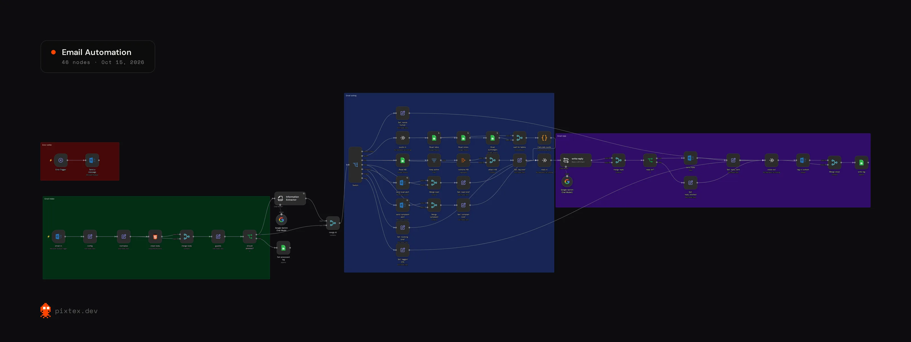

# AI Email Triage & Auto-Reply

Built for a courier company in Singapore and running live. It reads every customer email, works out what kind of email it is, replies to the ones it can handle, and tags the ones it isn't sure about for a person.

## The problem

Customer emails weren't getting prioritised. A lot of people inquire, especially law firms and hospitals that need deliveries every month, and slow replies meant lost work.

## What happens to each email

| Type | What the workflow does |
|---|---|
| FAQ | Replies with the answer from the knowledge base sheet |
| Quote question | Reads the rates, zones and surcharges sheets, calculates the quote, and replies |
| Booking | Replies to the booking |
| Potential lead | Replies, and alerts the owner if it's a big lead |
| Complaint | Replies, and alerts the owner |
| Needs human | Tags the email in Outlook for a person to handle |
| Spam | Tags it as spam |

## How it's built

1. **Intake.** An Outlook trigger picks up new mail. The body is cleaned of HTML and normalised, and guard checks skip mail the workflow shouldn't touch: already processed, no-reply and auto-reply senders, its own addresses, out-of-office replies and empty emails. Skipped mail is logged to a "not processed" sheet.
2. **Sorting.** Gemini, through an Information Extractor node, reads the email and pulls out the category, a confidence score and the details each branch needs. A Switch routes it. Anything under the confidence threshold goes to a person.
3. **Replying.** Each branch builds a short brief. A second Gemini step writes the reply from the brief and the knowledge base. Before it sends, a check blocks any reply that is missing its brief or still has a `[placeholder]` in the text.
4. **Close-out.** The email is tagged in Outlook and the outcome is written to a log sheet.
5. **Errors.** An error trigger emails me if any run fails.

Quotes are calculated in a Code node from the rate tables, not guessed by the AI.

**Stack:** n8n, Microsoft Outlook, Google Gemini, Google Sheets

## Results

The workflow replies right away and tells the owner about big leads. The fast replies have increased customers' trust in the company.

## Setup

Import `workflow.json`, connect Outlook, Gemini and Google Sheets credentials, and point the sheet nodes at your own knowledge base, rates, zones, surcharges and log sheets. Set your inbox addresses in the `config` node.
