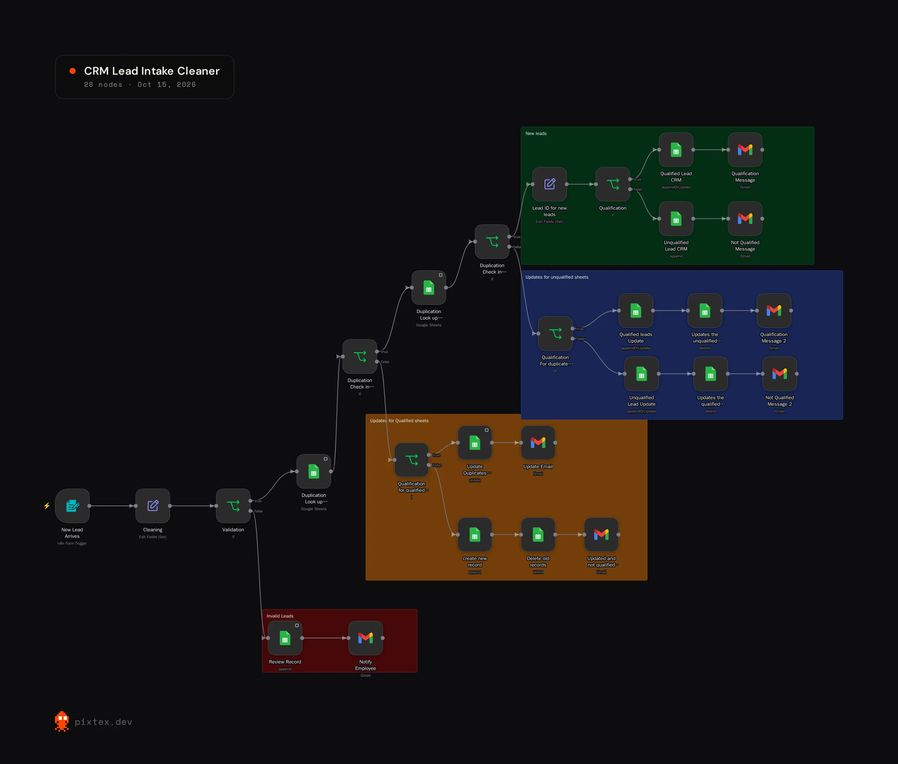

# CRM Lead Intake Cleaner

Cleans and validates every incoming lead, checks it against both the qualified and unqualified lead sheets, then decides whether to create, update or move the record.

## The problem

A single-field duplicate check let the same person into the CRM three times under a typo'd email. And when a lead's qualification changed, the old row stayed behind in the wrong sheet.

## What it does

1. **Intake.** A form trigger receives the lead. It's a form right now, but it can be swapped for a webhook or a website form.
2. **Cleaning and validation.** Fields are cleaned up. Incomplete records go to a review sheet, and an employee is emailed to look at them.
3. **Duplicate check.** The lead is looked up in both the qualified and the unqualified sheet, matching on name, email and phone, not one field.
4. **Qualification.** New leads get a Lead ID. Existing leads keep theirs and are updated in place instead of appended.
5. **Moving records.** If a lead's qualification changed, the old row is deleted and a new one is created in the right sheet.
6. **Emails.** Gmail sends the right message for each outcome: qualified, not qualified, updated, or needs review.

**Stack:** n8n, Google Sheets, Gmail

## Limitations

Conflicting email and phone matches go to a person instead of the workflow guessing. Structured logging and error handling are next on the list.

## Setup

Import `workflow.json`, connect Gmail and Google Sheets, and point the sheet nodes at your own sheets with three tabs: Qualified Leads, Unqualified Leads and Review Record. Google Sheets is the CRM here, but the sheet nodes can be swapped for a real CRM.
