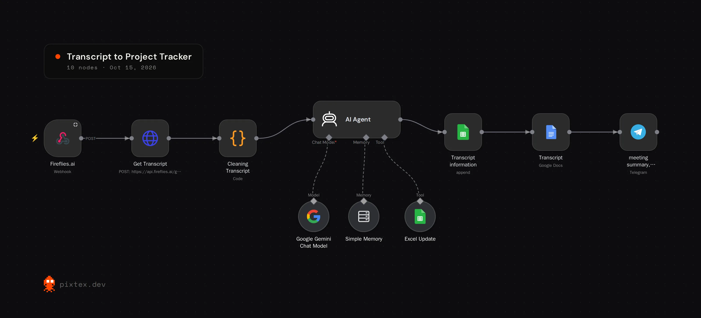

# Meeting Transcript to Project Tracker

I built this on my own because turning one meeting into tracker updates was taking me 1 to 2 hours. When a meeting ends, the workflow pulls the transcript, has an AI agent pick out what matters, and sends it where it needs to go.

## The problem

Commitments made out loud in a meeting stayed buried in a long transcript nobody re-read, so deadlines and owners were pieced together from memory afterwards.

## What it does

1. **Webhook.** Fireflies.ai calls the webhook when a meeting finishes.
2. **Get the transcript.** An HTTP request pulls the full transcript from the Fireflies GraphQL API.
3. **Clean it.** A Code node cleans the transcript and normalises the payload.
4. **AI agent.** An agent with a Gemini chat model and simple memory pulls out the meeting details, summary, highlights, tasks and deadlines. It has a Google Sheets tool so it can update the tracker itself.
5. **Deliver.** The meeting data is added to a Google Sheet, the full transcript goes into a Google Doc, and the summary, tasks and deadlines are sent to me on Telegram.

**Stack:** n8n, Fireflies.ai, Google Gemini, Google Sheets, Google Docs, Telegram

## What I ran into

Test and production webhook URLs differ, the payload shape changed between test and real events, and the AI node hit credit limits. I tested each node on its own, fixed the event path, and kept building against a mocked structured output instead of claiming a clean end-to-end run.

## Setup

Import `workflow.json`. Put your Fireflies API key in the `Get Transcript` node header (it says `YOUR_FIREFLIES_API_KEY`), connect Gemini, Google Sheets, Google Docs and Telegram, and set your Telegram chat ID.
