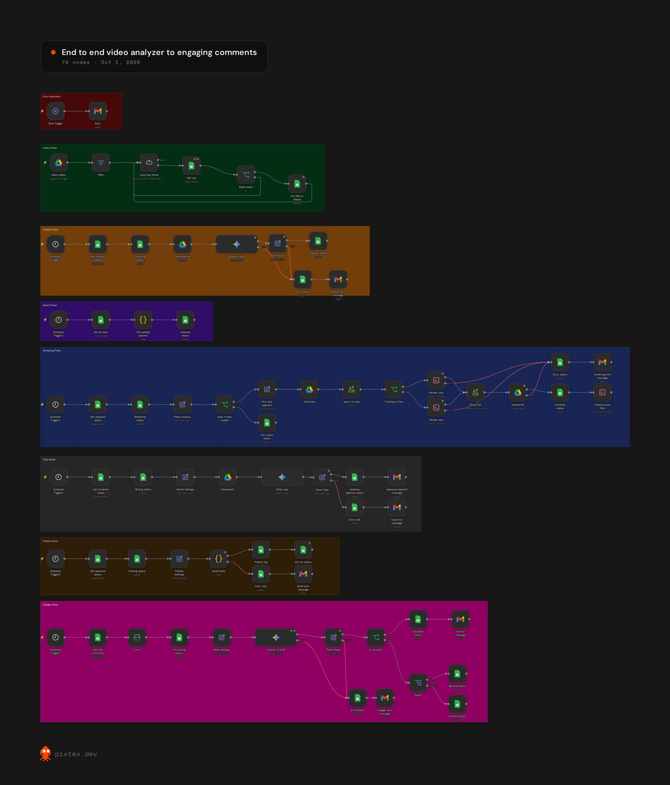

# Video Analyzer to Engaging Comments

A seven-phase pipeline for short video. Drop a video in a Google Drive folder and it gets analysed, cut into a vertical reel, captioned, approved, posted, and then the comments get answered. A Google Sheet is the ledger that moves each video from one phase to the next.

## The phases

1. **Intake.** A Google Drive trigger watches an inbox folder. New video files are checked against the ledger so nothing is processed twice.
2. **Analyze.** Gemini watches the video and scores its segments.
3. **Select.** A Code node finds batches that are ready to move on.
4. **Render.** The best-scoring segment (up to 15 seconds) is rendered to 1080x1920 with ffmpeg. If the shot can be cropped to vertical it's cropped; if not, it's padded over a blurred background. Videos with no usable footage are marked and skipped. The reel is uploaded to Drive and local files are cleaned up.
5. **Copy.** Gemini writes the caption in a set brand voice, and an approval email goes out. Nothing posts until it's approved.
6. **Publish.** Approved reels are built into posts and written to a publish log. There's a dry-run switch for testing.
7. **Engage.** New comments are classified and Gemini drafts a reply. Sensitive comments are escalated to a person by email instead of getting an automatic reply.

Every phase writes its status to the sheet and emails me if it fails, and an error trigger catches anything else.

**Stack:** n8n, Google Drive, Google Sheets, Gmail, Google Gemini, ffmpeg

## Setup

Import `workflow.json` and connect Google Drive, Google Sheets, Gmail and Gemini. The render phase uses the Execute Command node with ffmpeg, so it needs a self-hosted n8n with ffmpeg installed and a `/files` folder. Fill in your account IDs in the `Publish Settings` node, and edit `Brand Settings` and `Reply settings` for your voice and business facts.
