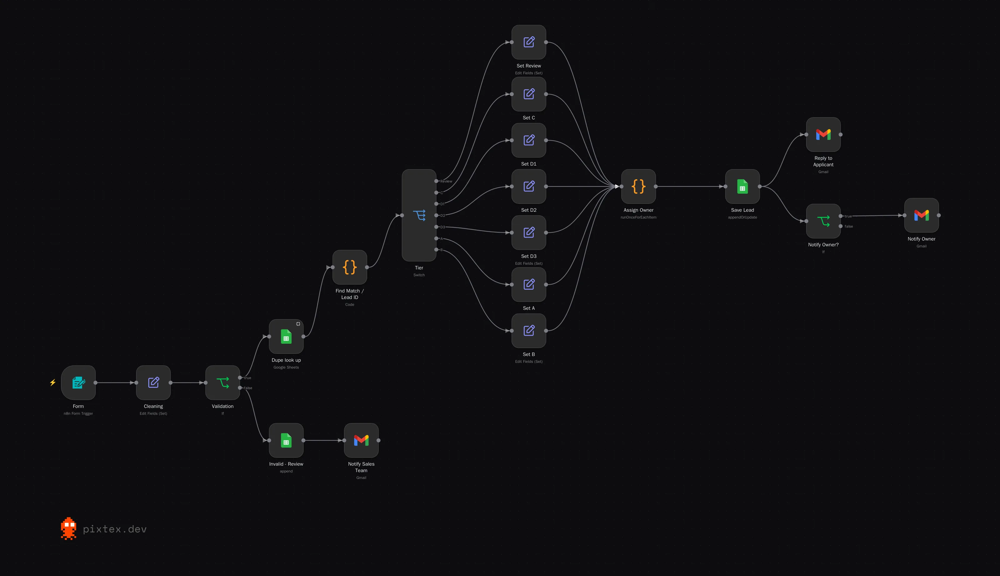

# Wholesale Lead Intake

A wholesale application form feeds this workflow. It cleans and validates each submission, checks for duplicates, sorts the applicant into a tier, assigns an owner, saves the lead, replies to the applicant and notifies the owner. I designed the flow and the business rules for a client interview; the brand name has been replaced with "Acme".

## What it does

1. **Form.** An n8n form collects the application.
2. **Cleaning and validation.** Invalid submissions go to a review sheet and the sales team gets an email.
3. **Duplicate check.** A Code node looks for the same email first, then the same phone number. A returning applicant keeps their Lead ID; a new one gets the next number. If the email and phone point to two different leads, it's flagged as a conflict.
4. **Tiers.** A Switch sorts the lead:
   - **Review:** a conflict, or business type "Other"
   - **C:** professional makeup artists
   - **D1:** outside the USA and Canada
   - **D2:** online retailers who sell on Amazon or other marketplaces
   - **D3:** US retailers and distributors with no resale certificate
   - **A:** retail stores, online retailers and distributors with a first order of $500 or more
   - **B:** everyone else who qualifies
5. **Assign owner.** C goes to the pro artist team, Review goes to operations, and D gets no owner. A and B go to the founder for distributors and $5,000+ first orders. Otherwise a returning lead keeps their old rep, and a new one goes to the rep with the fewest leads.
6. **Save and reply.** The lead is saved to the sheet (update if it exists, otherwise add), the applicant gets the reply for their tier, and the owner gets an alert if there is one.

**Stack:** n8n, n8n Form, Google Sheets, Gmail, JavaScript

## Setup

Import `workflow.json`, connect Gmail and Google Sheets, and change the team names and emails at the top of the `Assign Owner` node.
